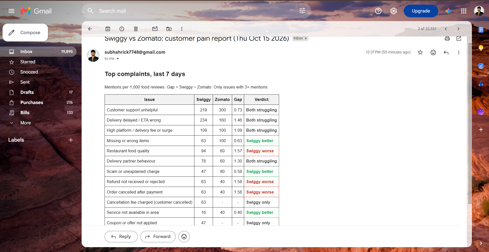
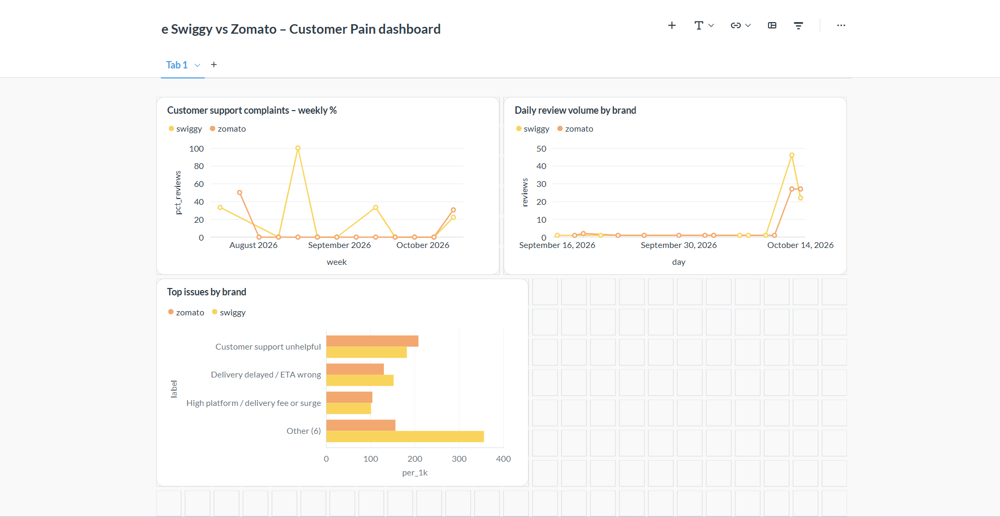
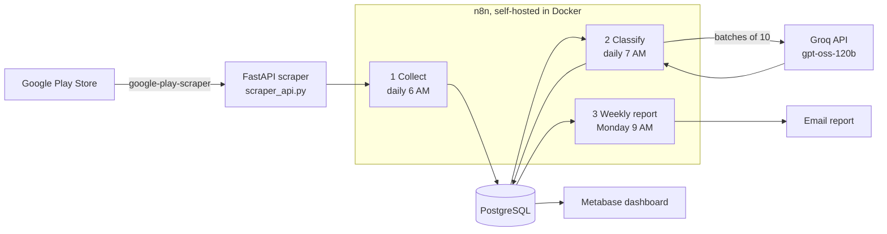

# Review-to-Roadmap Engine: Swiggy vs Zomato

An automated pipeline that collects Google Play reviews for Swiggy and Zomato every day, uses an LLM to classify each complaint into a fixed issue taxonomy (including Hindi and Hinglish reviews), and emails a weekly head-to-head report showing where each app is weaker.

**Business question:** *What are customers actually complaining about, and is it worse for us than for the competitor?*





---

## Architecture



| Workflow | Schedule | What it does |
|---|---|---|
| **1 – Collect reviews** | Daily, 6 AM | Calls the scraper API, upserts new reviews into `reviews` (deduplicated on Play Store review ID) |
| **2 – Classify reviews** | Daily, 7 AM | Sends unanalyzed reviews to the LLM in batches of 10, saves translation, service type and issue labels |
| **3 – Weekly report** | Monday, 9 AM | Computes mentions per 1,000 food reviews per brand, assigns a verdict, emails an HTML table |

## How classification works

- **Fixed taxonomy of 21 issue labels** (delivery delays, missing items, refunds, support, fees, cancellation fees, etc.). The model must reuse a known label when the meaning matches and may only propose a new one for a genuinely different problem.
- **Multilingual:** reviews in Hindi and Hinglish are translated to English as part of the same call.
- **Platform vs restaurant:** complaints about a restaurant's cooking get their own label, so platform problems are not inflated.
- **Severity 1–5** per issue (5 = lost money or could not use the app).
- **Structured output:** the model returns JSON keyed by a short batch index, so long review IDs cannot be garbled.
- **Fault tolerance:** a batch that fails to parse leaves its reviews unanalyzed, and they are retried on the next run.

## Comparison method

Raw counts are misleading when one app gets more reviews, so the report uses **mentions per 1,000 food reviews** for each brand:

- `gap = Swiggy rate ÷ Zomato rate`
- gap > 1.5 → **Swiggy worse** · gap < 0.67 → **Swiggy better** · otherwise **Both struggling**
- Issues with fewer than 3 total mentions are hidden as noise.

## Validation

| Check | Result |
|---|---|
| Manual label check (random sample of 48 review–label pairs) | **43 / 48 correct ≈ 90% label precision** |
| Main error types found | Customer-cancellation fees confused with platform cancellations; "scam" used as a catch-all; feature suggestions labelled as no issue |
| Fixes applied | Added labels (*Cancellation fee charged*, *Menu prices higher than restaurant*, *Offers or discounts reduced*) and explicit prompt rules |

**Limitation:** this measures precision (are the assigned labels right?), not recall (did the model catch every issue in a review?).

## First findings (one week of data)

Based on roughly 64 Swiggy and 50 Zomato food reviews, so treat these as **directional**:

- **Customer support is the #1 complaint for both apps** (about 22% of Swiggy and 30% of Zomato food reviews), often citing AI chatbots and no human agent.
- **Delivery delays lean worse for Swiggy** (234 vs 160 per 1,000).
- **Full-amount cancellation fees appear only in Swiggy reviews.**

Smaller gaps (2–4 reviews per side) are not yet statistically meaningful; the daily pipeline grows the sample automatically.

## Tech stack

n8n (self-hosted) · PostgreSQL 16 · Python (FastAPI, google-play-scraper, pandas) · Groq API (`openai/gpt-oss-120b`, free tier) · Docker Compose · Metabase · Gmail SMTP

## Repository structure

```
├── docker-compose.yml        # n8n + Postgres + Metabase
├── schema.sql                # reviews, review_issues tables
├── scraper_api.py            # FastAPI endpoint n8n calls
├── engine.py                 # one-off scraper to CSV (exploration)
├── explore.py                # data cleaning and sanity checks
├── classify_groq.py          # prompt development and accuracy testing
├── workflows/                # exported n8n workflow JSON files
└── docs/                     # screenshots
```

## Run it locally

1. Install Docker Desktop and Python 3.11+.
2. Create `.env` with `GROQ_API_KEY=...` (never commit it).
3. Start the services:
   ```bash
   docker compose up -d
   python -m venv .venv && .venv/Scripts/activate
   pip install fastapi uvicorn google-play-scraper pandas groq python-dotenv
   uvicorn scraper_api:app --host 0.0.0.0 --port 8000
   ```
4. Open n8n at `http://localhost:5678`, import the files in `workflows/`, and add three credentials: Postgres (host `postgres`, port `5432`), Header Auth for Groq (`Authorization: Bearer <key>`), and SMTP.
5. Publish the three workflows.

## Limitations and next steps

- Play Store reviews carry no location, so there is no city-level analysis.
- Unhappy users review more often; figures are relative comparisons, not satisfaction scores.
- The pipeline runs only while the host machine is on; a small cloud VM would make it always-on.
- Next: Jira ticket creation for "Swiggy worse" issues, recall evaluation, and App Store reviews.
